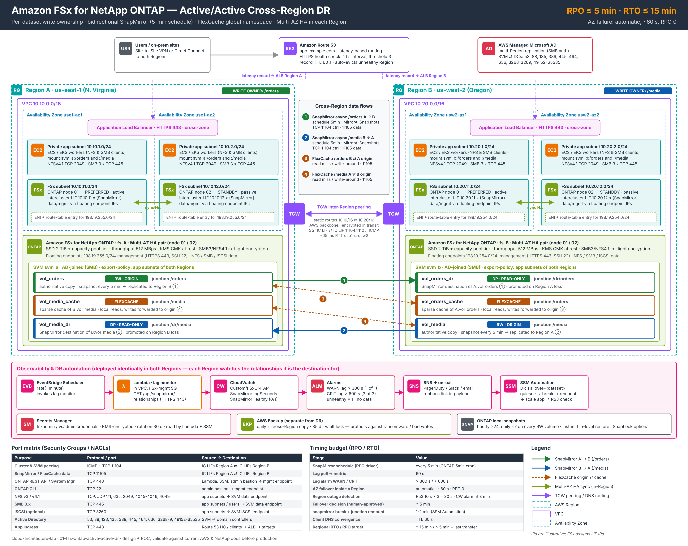

# 01 · FSx for NetApp ONTAP: active/active cross-Region DR (RPO 5 min)

**Goal:** Shared NFS/SMB storage that serves reads and writes in two AWS Regions at the same time, survives the loss of a whole Region, and loses at most ~5 minutes of data.



<sub>Vector version: [diagrams/architecture.svg](diagrams/architecture.svg). Regenerate with `python3 diagrams/build_diagram.py`.</sub>

| | Target | How |
|---|---|---|
| **RPO, Region loss** | ≤ 5 min (+ duration of the last transfer) | Async SnapMirror on the ONTAP `5min` schedule, lag alarmed at 300 s |
| **RTO, Region loss** | ≤ 15 min | Route 53 health checks (30 s), human-approved promote via SSM runbook |
| **AZ loss** | automatic, ~60 s, RPO 0 | FSx Multi-AZ HA pair in each Region |
| **Logical corruption / ransomware** | point-in-time | ONTAP snapshots + AWS Backup cross-Region copies with vault lock |

---

## 1. What "active/active" means here

The design is honest about what storage can do across ~65 ms of latency. Two Regions can't both own the **same** file with strong consistency at that distance, so ownership is split per dataset:

| Dataset | Write owner (RW origin) | DR copy (SnapMirror DP) | Served in the other Region by |
|---|---|---|---|
| `/orders` | Region A, us-east-1 | `svm_b:vol_orders_dr` | FlexCache `vol_orders_cache` in B |
| `/media` | Region B, us-west-2 | `svm_a:vol_media_dr` | FlexCache `vol_media_cache` in A |

- **Both Regions take live traffic.** Route 53 latency routing sends users to the closest healthy Region.
- **Both Regions see the same namespace.** `/orders` and `/media` resolve in each SVM. One is the local origin, the other is a FlexCache.
- **FlexCache:** hot reads are served locally. Writes are forwarded (write-around) to the origin and are strongly consistent, at the cost of cross-Region latency.
- **SnapMirror** keeps a full, independent, read-only copy of each dataset in the other Region every 5 minutes. That copy is what gets promoted when the owning Region fails. The FlexCache doesn't need the origin for hot reads, but can't serve writes or misses without it.

Place each dataset's owner in the Region where most of its writes happen.

## 2. Components

| Layer | Service | Key settings |
|---|---|---|
| DNS / traffic | Route 53 | latency records per Region, HTTPS health check every 10 s, failure threshold 3, TTL 60 s |
| App ingress | ALB | HTTPS 443, cross-zone, targets in private app subnets |
| Compute | EC2 / EKS | NFSv4.1 (2049) / SMB 3.x (445) clients, `hard` mounts |
| Storage | FSx for NetApp ONTAP | `MULTI_AZ_1`, SSD + capacity-pool tiering, 512 MBps, KMS CMK |
| Replication | SnapMirror async | policy `MirrorAllSnapshots`, schedule `5min`, intercluster LIFs |
| Global namespace | FlexCache | cache of the peer origin, mounted at the same junction path |
| Inter-Region network | Transit Gateway peering | explicit TGW route tables, static routes 10.10/16 ⇄ 10.20/16 |
| Identity | AWS Managed Microsoft AD | multi-Region replication, so SMB auth works after failover |
| Secrets | Secrets Manager | `fsxadmin`/`vsadmin`, used by Lambda + SSM, 30-day rotation |
| Observability | EventBridge → Lambda → CloudWatch → SNS | `SnapMirrorLagSeconds`, `SnapMirrorHealthy` per destination |
| Automation | SSM Automation | `DR-Failover-<dataset>`: quiesce → break → remount → scale → verify |
| Backup | ONTAP snapshots + AWS Backup | local hourly/daily snapshots, daily cross-Region copy, 35 days, vault lock |

## 3. Network and ports

| Purpose | Protocol / port | Source → destination |
|---|---|---|
| Cluster & SVM peering | ICMP + TCP 11104 | IC LIFs A ⇄ IC LIFs B |
| SnapMirror / FlexCache data | TCP 11105 | IC LIFs A ⇄ IC LIFs B |
| ONTAP REST API / System Manager | TCP 443 | Lambda, SSM, bastion → management endpoint |
| ONTAP CLI | TCP 22 | bastion → management endpoint |
| NFS v3 / v4.1 | TCP/UDP 111, 635, 2049, 4045-4046, 4049 | app subnets → SVM |
| SMB 3.x | TCP 445 | app subnets / users → SVM |
| iSCSI (optional) | TCP 3260 | app subnets → SVM |
| Active Directory | 53, 88, 123, 135, 389, 445, 464, 636, 3268-3269, 49152-65535 | SVM → domain controllers |
| App ingress | TCP 443 | clients / Route 53 health checkers → ALB |

**Multi-AZ routing detail:** In a Multi-AZ file system, the management and data endpoints are **floating IPs outside the VPC CIDR** (`198.19.255.0/24` in A, `198.19.254.0/24` in B). FSx programs them into the route tables you pass in. The intercluster LIFs are ordinary subnet IPs, so cross-Region SnapMirror and FlexCache only need routes between the VPC CIDRs. Give each Region a distinct endpoint range anyway, in case you later route client traffic between them.

## 4. Timing budget

| Stage | Value |
|---|---|
| SnapMirror schedule | every 5 min |
| Lag poll → metric | 60 s |
| Lag alarm WARN / CRIT | > 300 s (1 of 1) / > 600 s (3 of 3) |
| In-Region AZ failover | automatic, ~60 s, RPO 0 |
| Region outage detection | Route 53 10 s × 3 = 30 s · CloudWatch ≤ 3 min |
| Failover decision | ≤ 5 min (one human approval) |
| `snapmirror break` + junction remount | 1-2 min |
| Client DNS convergence | TTL 60 s |
| **Regional RTO / RPO** | **≤ 15 min / ≤ 5 min + last transfer duration** |

**RPO math:** Worst-case loss = schedule interval + time the in-flight transfer had left. Five minutes is the shortest supported async SnapMirror interval. If you need a hard ≤ 5 min, keep each transfer well under a minute: size throughput for peak change rate and alarm on the lag, not on the schedule.

## 5. Sizing the 5-minute RPO

```
change per interval    = peak write rate × 300 s
required throughput   >= change per interval / target transfer time
example: 30 GB/h peak  -> 2.5 GB per 5 min -> at ~100 MB/s effective cross-Region ≈ 25 s per transfer  ✔
```

- FSx throughput capacity is shared by clients, tiering and SnapMirror. Leave headroom (≥ 30 %) for replication at peak.
- SnapMirror ships changed blocks after storage efficiency, so dedupe/compression reduce cross-Region bytes.
- Inter-Region data transfer is billed per GB on both the SnapMirror and the FlexCache paths. Check current pricing for your Region pair.

## 6. Failure modes

| Failure | Impact | Response |
|---|---|---|
| One ONTAP node / AZ | none visible; ~60 s I/O pause | automatic FSx failover/failback |
| TGW peering / inter-Region path | FlexCache misses and remote writes fail; local origins fine; lag grows | WARN/CRIT alarms; fix network; SnapMirror catches up |
| Region A | `/orders` read-only in B until promoted | [runbook A](docs/runbook.md#a-unplanned-failover-region-a-lost) |
| Region B | `/media` read-only in A until promoted | same runbook, A ↔ B |
| Accidental delete / ransomware | change replicates within 5 min | restore from ONTAP snapshot or AWS Backup copy, **not** from the DR copy |

## 7. Deploy the POC

```bash
cd terraform
cp terraform.tfvars.example terraform.tfvars   # set alarm_email
terraform init
terraform apply                                # ~45-60 min: two Multi-AZ file systems
terraform output
```

Then follow [docs/ontap-setup.md](docs/ontap-setup.md) for cluster/SVM peering, SnapMirror, FlexCache and mounts. Rehearse with [docs/runbook.md](docs/runbook.md).

What Terraform creates per Region: VPC, app + FSx subnets in 2 AZs, Transit Gateway (+ inter-Region peering and static routes), security groups with the port matrix above, VPC endpoints (Secrets Manager, CloudWatch, Logs, SNS), a Multi-AZ FSx for ONTAP file system, the SVM, the RW and DP volumes, and the lag-monitor Lambda with its alarms and SNS topic.

> 💸 **Cost warning:** Two Multi-AZ FSx for ONTAP file systems at 512 MBps, plus two TGWs and their attachments, cost real money per hour. Run `terraform destroy` when you're done. This is a learning POC: before production, add Route 53/ALB/compute, AD join for SMB, a CA-signed ONTAP certificate (`VERIFY_TLS=true`), remote Terraform state, and least-privilege export policies.

## 8. Repo layout

```
01-fsx-ontap-active-active-dr/
├── diagrams/            architecture.svg / .png + build_diagram.py
├── terraform/           root (two Regions, TGW peering, volumes) + modules/region, modules/monitoring
├── lambda/              snapmirror_lag_monitor.py (ONTAP REST -> CloudWatch)
└── docs/                ontap-setup.md, runbook.md
```

## References

- [Amazon FSx for NetApp ONTAP user guide](https://docs.aws.amazon.com/fsx/latest/ONTAPGuide/what-is-fsx-ontap.html): Multi-AZ, endpoints, SnapMirror
- [NetApp ONTAP: SnapMirror and data protection](https://docs.netapp.com/us-en/ontap/data-protection/index.html)
- [NetApp ONTAP: FlexCache](https://docs.netapp.com/us-en/ontap/flexcache/index.html)
- [Network ports for ONTAP intercluster traffic](https://docs.netapp.com/us-en/ontap/networking/ontap_internal_ports.html)

*Validate the settings against current AWS and NetApp documentation before production use.*
